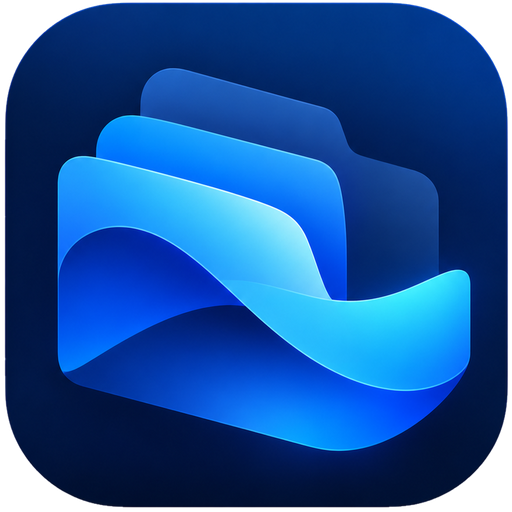

# FileFlow

**Your files. In flow.**

FileFlow is a desktop app for exploring and organising local files. Scan folders, understand what takes up space, save favourites, add tags, and review duplicate files or visually similar images in one workspace.

Built with Java 21, JavaFX and SQLite. Available for Windows and macOS, with English and Simplified Chinese interfaces.

## Download

[Release notes and all downloads](https://github.com/Austin-Sha789/FileFlow/releases)

| Platform | FileFlow 1.0.0 installer |
| --- | --- |
| Windows x64 | [Download MSI](https://github.com/Austin-Sha789/FileFlow/releases/download/v1.0.0/FileFlow-1.0.0-windows-x64.msi) |
| Mac with Apple Silicon (M series) | [Download ARM64 DMG](https://github.com/Austin-Sha789/FileFlow/releases/download/v1.0.0/FileFlow-1.0.0-macos-arm64.dmg) |
| Mac with an Intel processor | [Download x64 DMG](https://github.com/Austin-Sha789/FileFlow/releases/download/v1.0.0/FileFlow-1.0.0-macos-x64.dmg) |

Installers include a Java runtime; Java and Maven are only needed to build from source. On Windows, run the MSI installer. On macOS, open the DMG and drag FileFlow into Applications.

The first release is not signed with a developer identity. Windows may show an unknown-publisher prompt. Mac builds use an ad-hoc signature, are not notarised by Apple, and may be blocked by Gatekeeper on first launch.

## Features

- **Browse and search:** navigate scanned folders, filter file types, and sort results.
- **Storage overview:** review file-type usage, folder sizes and disk capacity.
- **Favourites and tags:** keep useful files close and organise them across folders.
- **Exact duplicates:** compare file contents and review duplicate groups before resolving them.
- **Similar images:** group visually similar images for review.
- **Static previews:** view image thumbnails and video posters in file lists and Quick Info.
- **Saved workspaces:** add persistent folder shortcuts through Manage Folders. Ordinary scans do not add shortcuts automatically.
- **Desktop settings:** switch language, customise shortcuts, choose deletion confirmation behaviour, and check for updates.

The Ocean interface uses a dark blue theme. Mac builds use native window controls in the top-left corner and place the app brand on the right of the application toolbar.

## Getting started

1. Choose **Scan Folder** to inspect a folder.
2. Open **Files** to browse its contents, or **Dashboard** for a storage overview.
3. Use **Manage Folders** to save folders in the workspace sidebar.
4. Review candidates in **Duplicates** before resolving them. File removal uses the system Recycle Bin or Trash.
5. Open **Settings** to change language or use **Software updates**.

A scan is temporary unless you explicitly save a workspace folder. Saved folder paths survive restarts; scan snapshots are held in memory, so a saved folder is scanned again when opened in a new session.

### Default shortcuts

| Action | Windows | macOS |
| --- | --- | --- |
| Refresh the current scan | Ctrl+R | Command+R |
| Search files | Ctrl+F | Command+F |
| Scan a folder | Ctrl+Shift+O | Command+Shift+O |

Shortcuts can be changed in Settings.

## Known issues

- [#1: MOV video thumbnails may not appear on macOS](https://github.com/Austin-Sha789/FileFlow/issues/1). FFmpeg discovery and a native Quick Look fallback are implemented, but the reported issue remains unresolved.
- Mac appearance, media codec coverage and system permissions still need broader testing. Packaged startup checks do not replace manual installation and upgrade testing.

Please [open an issue](https://github.com/Austin-Sha789/FileFlow/issues) with your OS version, app version, processor architecture, reproduction steps, and a sample or log when appropriate.

## Run from source

Requirements: JDK 21 or newer, Maven, Git, and a graphical desktop session. Set `JAVA_HOME` to your JDK and make Maven available on `PATH`.

```sh
git clone https://github.com/Austin-Sha789/FileFlow.git
cd FileFlow
```

On **Windows x64**, prepare the bundled video decoder once from PowerShell:

```powershell
./scripts/setup-video-thumbnails.ps1
```

The setup script downloads a pinned FFmpeg build and verifies its SHA-256. The prepared binary archive is ignored by Git and included in the Windows application at build time.

On **macOS**, FileFlow can use FFmpeg on `PATH` or in common Homebrew/MacPorts locations. If decoding fails or FFmpeg is unavailable, it tries the system Quick Look thumbnail generator. Quick Look support depends on macOS and the video codec; see the known MOV issue above. A distributable Mac FFmpeg bundle is not included.

Start the app on either platform:

```sh
mvn clean javafx:run
```

## Tests

```sh
# Unit and service tests
mvn test

# Include desktop UI integration tests (requires a graphical session)
mvn -Dfileflow.fxTests=true test

# Include real video decoding tests (requires the prepared Windows engine or FFmpeg)
mvn -Dfileflow.videoTests=true test
```

Both flags can be combined. Video tests use FFmpeg to generate fixtures, including when testing the native Mac fallback. Test preferences use an in-memory store. Environments with restricted temporary-file operations may need an explicitly writable `java.io.tmpdir`; see [video thumbnail verification](docs/video-thumbnails.md#verification).

## Build installers and publish updates

Installers must be built on their target operating system. The release workflow builds Windows x64, Mac ARM64 and Mac x64 separately, tests each application image, and publishes only after all three builds succeed.

For a local build, use JDK 21+, Maven and Python 3. Windows MSI packaging also requires WiX compatible with the selected JDK. Prepare the Windows video decoder first, then run:

```sh
python scripts/package-release.py --version 1.0.0
```

The version must match `pom.xml`. Use `--image-only` to build and test an application image without creating an installer. Native installers, checksum files and startup reports are written to `dist/`.

For subsequent releases, update the POM version, add `docs/releases/<version>.md`, push the changes, and run **Actions → Release installers → Run workflow** with that version. See [updates and publishing](docs/updates.md) for asset naming, verification and the in-app update flow.

## Application data

| Data | Windows | macOS |
| --- | --- | --- |
| Database: favourites, tags and scan history | `%LOCALAPPDATA%/FileFlow/fileflow.db` | `~/Library/Application Support/FileFlow/fileflow.db` |
| Preview cache | `%LOCALAPPDATA%/FileFlow/Cache` | `~/Library/Caches/FileFlow` |
| Downloaded updates | `%LOCALAPPDATA%/FileFlow/Updates` | `~/Library/Caches/FileFlow/Updates` |

Language, shortcuts and saved workspace paths use Java Preferences. When started from a legacy source directory containing `fileflow.db`, FileFlow can make a consistent copy into the user data directory without deleting the original or replacing an existing target database. An installed app does not search old repositories for databases; see [migration details](docs/updates.md#application-data-and-installer-identity).

## Documentation

- [Updates and publishing](docs/updates.md)
- [Video thumbnails](docs/video-thumbnails.md)
- [Saved workspace folders](docs/workspace-folders.md)
- [macOS Dock icon and video previews](docs/mac-preview-and-scan-fixes.md)
- [macOS native window controls](docs/mac-window-chrome.md)
- [Resolve scroll position](docs/resolve-position.md)
- [Ocean theme coverage](docs/theme-polish.md)
- [FFmpeg third-party notice](THIRD_PARTY_VIDEO.md)
